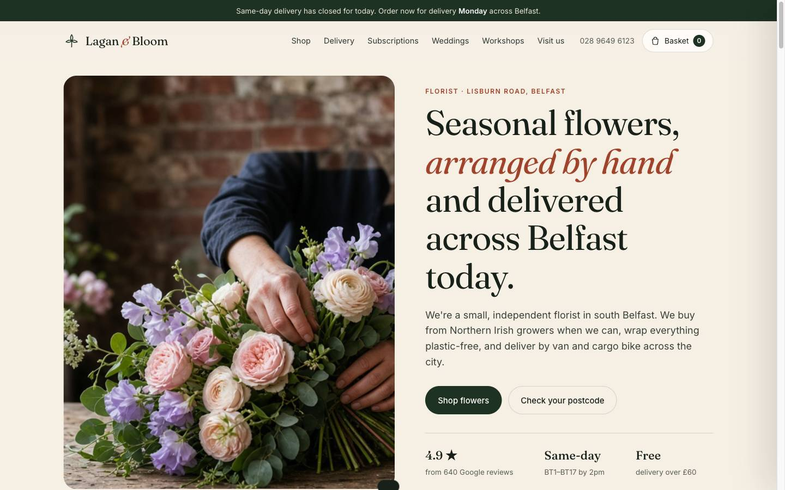
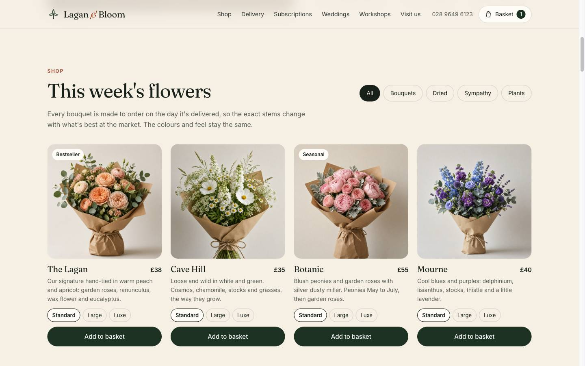

# Lagan & Bloom

A realistic website for an independent florist on Lisburn Road, Belfast. It covers the things a real local flower shop needs: an online shop, same-day delivery by postcode, subscriptions, wedding enquiries, workshops and opening hours.

> **Demo project.** The business, people, reviews and phone number are fictional. No payments are taken and no orders or forms are sent anywhere.





## Features

- **Shop** with category filters (bouquets, dried, sympathy, plants), size options and a basket that persists between visits.
- **Postcode delivery checker** using Belfast delivery zones:

  | Zone | Postcodes | Fee | Same-day cut-off |
  |---|---|---|---|
  | Belfast | BT1–BT17 | £5.95, free over £60 | 2pm |
  | Greater Belfast | BT18, 23, 27–29, 36–38 | £8.95, free over £80 | 12pm |
  | Rest of Northern Ireland | other BT postcodes | £9.95 courier | Next day, Tue–Sat |

- **Live same-day countdown** and **open/closed status**, calculated in Belfast time (`Europe/London`), whatever the visitor's timezone.
- **Checkout** with delivery or click & collect, delivery date picker, gift message, validation and an order confirmation.
- **Subscriptions**, **wedding enquiry form**, **workshop booking** (including sold-out sessions), reviews, FAQ, newsletter and an OpenStreetMap embed.
- Responsive layout, keyboard-accessible basket drawer, `prefers-reduced-motion` support and `Florist` structured data for search engines.

## Tech

- [Vite](https://vite.dev) with plain JavaScript (no framework)
- [Lenis](https://github.com/darkroomengineering/lenis) for smooth scrolling
- Product and shop data live in `src/data.js`, so prices, hours, zones and workshops are easy to change

## Running locally

Requires Node.js 20 or newer.

```bash
npm install
npm run dev      # development server
npm run build    # production build in dist/
npm run preview  # preview the production build
```

## Project structure

```text
index.html         Page markup and all sections
src/main.js        UI: shop, basket, checkout, forms, hours
src/data.js        Products, opening hours, delivery zones, workshops
src/delivery.js    Postcode validation, zones, fees and delivery dates
src/time.js        Belfast-time helpers
src/cart.js        Basket state (localStorage)
src/style.css      Styles
public/img/        Photography
```

## Making it real

To run this for an actual shop you'd need real photography, a payment provider (for example Stripe or Shopify) and a way for orders and enquiries to reach the shop, such as a form backend or email service.

## Credits

Images were generated with AI for demonstration purposes. Map data © [OpenStreetMap](https://www.openstreetmap.org/copyright) contributors.
